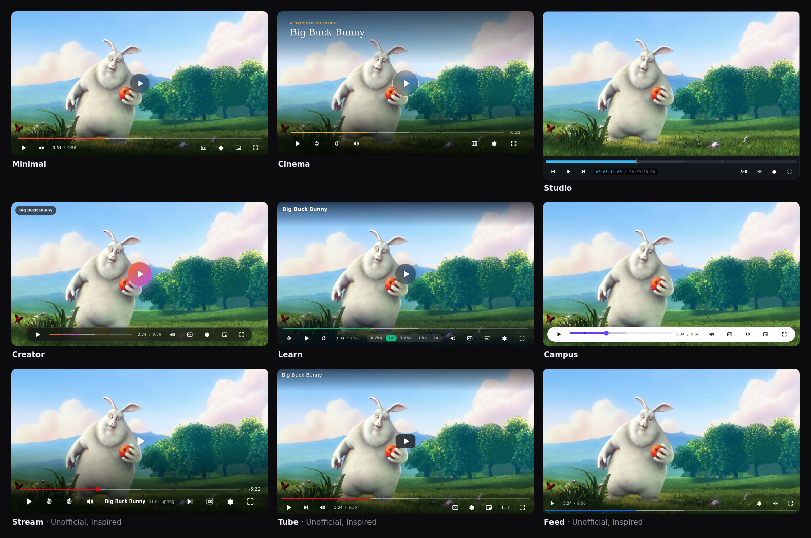
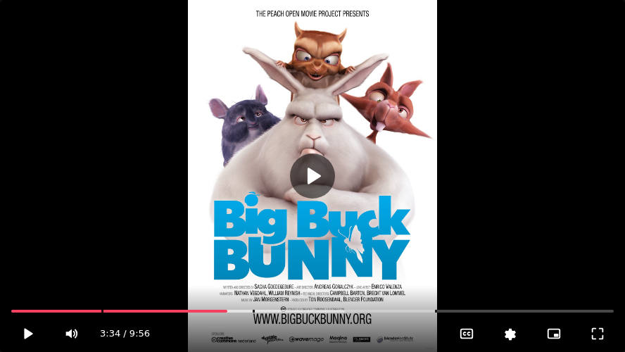
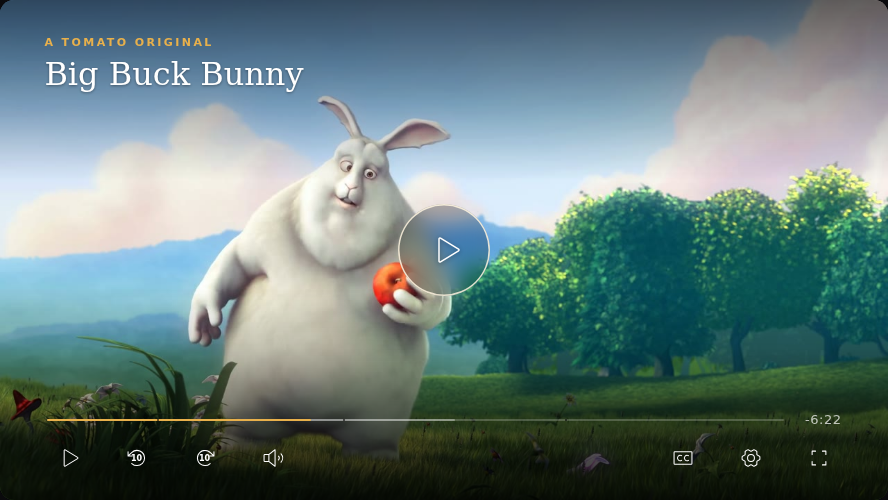
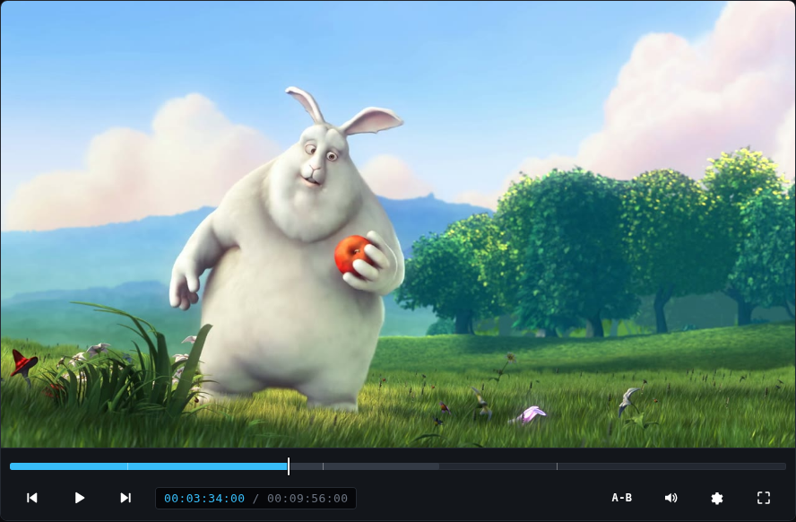
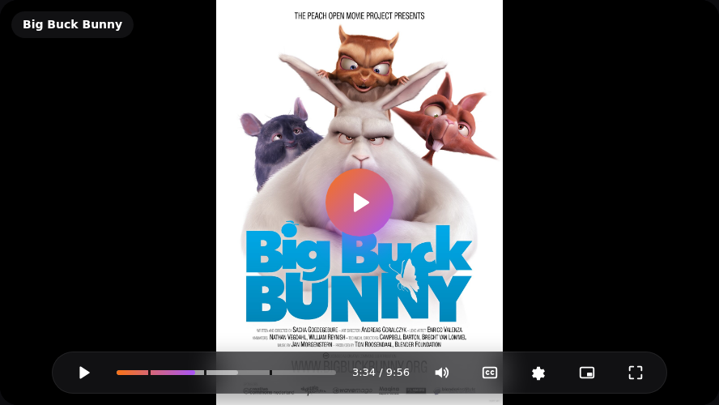
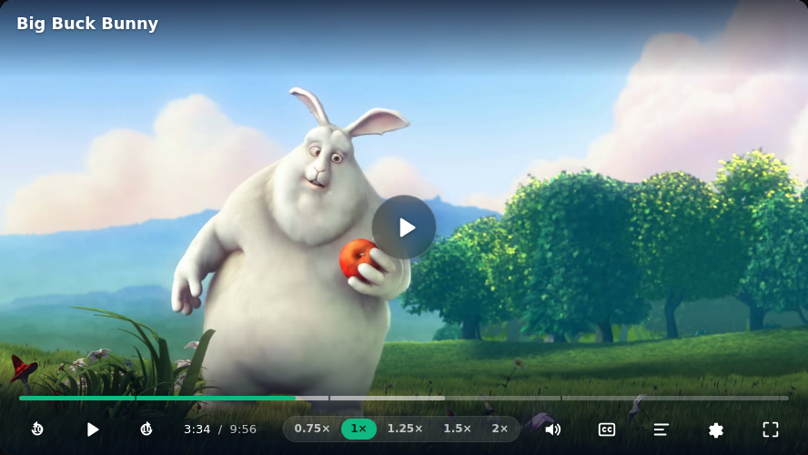
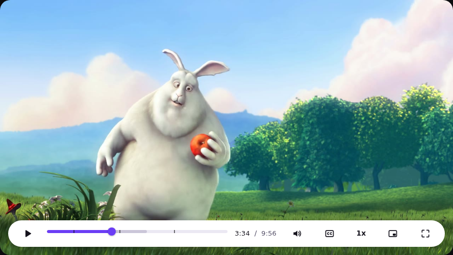
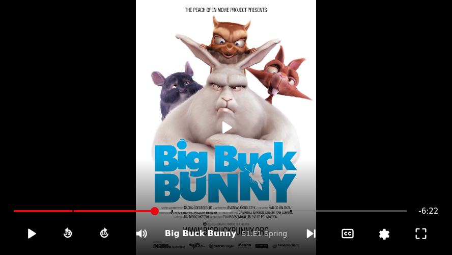
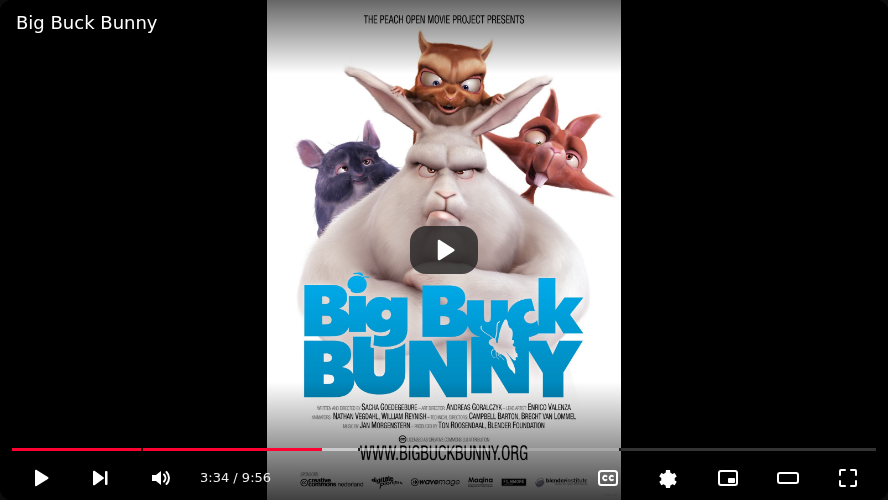
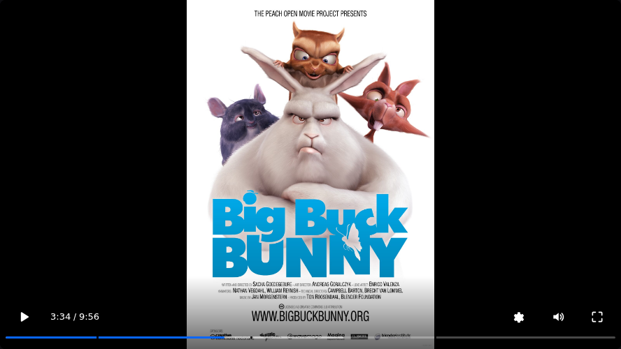

<div align="center">


# Tomato Player

**One player. A thousand possibilities.**

A modular, accessible, SSR-safe video player ecosystem for the web.<br/>
A tiny core, swappable skins, community plugins, HLS/DASH on demand, and first-class React, Vue, Svelte and HTML support.

[](https://github.com/playlikeboy/tomato-player/actions/workflows/ci.yml)
[](LICENSE)


**[🌐 Website](https://playlikeboy.github.io/tomato-player/)** · **[▶ Live skin gallery](https://playlikeboy.github.io/tomato-player/gallery/)** · **[🧪 Playground](https://playlikeboy.github.io/tomato-player/playground/)** · [📚 Docs](https://playlikeboy.github.io/tomato-player/docs/) · [Research](https://playlikeboy.github.io/tomato-player/docs/research/) · [llms.txt](https://playlikeboy.github.io/tomato-player/llms.txt)



</div>

---

## Why Tomato Player?

Picking a web video player usually means choosing between **a heavy all-in-one** (big bundle, hard to restyle), **a pretty but abandoned** project, or **a headless toolkit** where you build every control yourself. Tomato Player is designed around the problems developers actually report ([research](docs/research/developer-pain-points.md)):

| Pain point | What Tomato Player does |
| --- | --- |
| Bundle bloat | The core is **5.7 KB gz**, and core + UI + Minimal skin is about **15.7 KB gz**. hls.js and dash.js are optional peers, loaded with `import()` only when a stream needs them, and never on Safari, which plays HLS natively. |
| SSR / hydration crashes | **Zero work at import time**: no package touches `window` until `createPlayer()` runs. The React binding is tested with `renderToString` and Strict Mode. |
| Restyling is painful | **Skins are swappable packages**: state lives in `data-*` attributes, design tokens in CSS variables, and you can change skins at runtime with `player.setSkin()`. |
| Memory leaks in SPAs | Every listener is bound to an `AbortSignal`. `destroy()` is idempotent and restores the DOM exactly. |
| iPhone fullscreen hides your UI | `fullscreenFallback: 'pseudo'` keeps your skin on iOS. |
| Poor accessibility | Real buttons, sliders with `aria-valuetext`, keyboard menus, focus rings, reduced-motion and forced-colors support. Tests assert every control has a name. |
| Abandoned libraries | Plyr is deprecated and Vidstack is security-only. See the [migration guides](docs/migration/README.md). |

## Quick start

```sh
npm i @tomato-player/core @tomato-player/skin-minimal
```

```ts
import { createPlayer } from '@tomato-player/core';
import { minimal } from '@tomato-player/skin-minimal';

const player = createPlayer('#player', {
  src: 'https://example.com/movie.mp4',
  poster: 'https://example.com/poster.jpg',
  title: 'My movie',
  skin: minimal(),
});

player.on('ended', () => console.log('🍅 done'));
```

### No build step

```html
<script src="https://cdn.jsdelivr.net/npm/tomato-player@0/dist/tomato-player.global.js"></script>

<tomato-player src="movie.mp4" poster="poster.jpg" title="My movie" skin="cinema" accent="#f59e0b">
  <track kind="captions" src="en.vtt" srclang="en" label="English" />
</tomato-player>
```

Also on unpkg (`https://unpkg.com/tomato-player`) and as browser ESM (`https://esm.sh/tomato-player`). The all-in CDN build ships **every skin and plugin in about 26 KB gz**.

### React · Vue · Svelte

```tsx
import { TomatoPlayer } from '@tomato-player/react';
<TomatoPlayer src="movie.mp4" skin={skin} plugins={plugins} onReady={(p) => p.play()} />
```

```vue
<TomatoPlayer src="movie.mp4" :skin="skin" @ready="onReady" />
```

```svelte
<div use:tomato={{ src: 'movie.mp4', skin }} />
```

Angular, Astro, Solid, Lit and anything else that renders HTML can use `import 'tomato-player/element'` and the `<tomato-player>` web component. See [Frameworks](docs/guides/frameworks.md).

### Streaming

```sh
npm i @tomato-player/provider-hls hls.js
```

```ts
import { hls } from '@tomato-player/provider-hls';
createPlayer('#player', { src: 'https://example.com/master.m3u8', providers: [hls()] });
```

Adaptive quality, audio tracks, live/DVR and error recovery are built in. DASH works the same way with `@tomato-player/provider-dash`. For DRM, see [Streaming](docs/guides/streaming.md).

## Skins

Every skin is its own package (0.6–2.7 KB gz), is themeable with tokens, and can be swapped at runtime.

| | Skin | Built for |
| --- | --- | --- |
|  | **Minimal**<br/>`@tomato-player/skin-minimal` | Clean, lightweight default |
|  | **Cinema**<br/>`@tomato-player/skin-cinema` | Premium storytelling: serif titles, gold gradient |
|  | **Studio**<br/>`@tomato-player/skin-studio` | Pros: SMPTE timecode, frame stepping, A-B loop |
|  | **Creator**<br/>`@tomato-player/skin-creator` | Expressive: floating glass pill, gradients, cast |
|  | **Learn**<br/>`@tomato-player/skin-learn` | Courses: speed chips, ±10 s, chapter panel, big captions |
|  | **Campus**<br/>`@tomato-player/skin-campus` | Ported from the [CampusLoop](https://campusloop.space) landing page: paper sticker strip, sticker captions, tap to unmute, 9:16 on phones |
|  | **Stream** *(unofficial)*<br/>`@tomato-player/skin-stream` | Streaming-service patterns, next-episode flow |
|  | **Tube** *(unofficial)*<br/>`@tomato-player/skin-tube` | Video-platform patterns, theater mode |
|  | **Feed** *(unofficial)*<br/>`@tomato-player/skin-feed` | Social-feed patterns: muted autoplay in view |

```ts
cinema({ eyebrow: 'Original', tokens: { accent: '#38bdf8', radius: '0px' } });
```

> **Want to build skin #10?** Run `pnpm new skin <name>`. See [Create a skin](docs/guides/create-a-skin.md). The long-term goal is a searchable gallery of 1,000+ community skins.

## Plugins

| Plugin | gz | |
| --- | --- | --- |
| `plugin-hotkeys` | 0.9 KB | YouTube-style shortcuts, remappable, never hijacks inputs |
| `plugin-gestures` | 0.8 KB | Double-tap to seek with ripples |
| `plugin-chapters` | 0.5 KB | Array or WebVTT, seek-bar markers, chapter titles in preview |
| `plugin-thumbnails` | 0.5 KB | WebVTT sprite previews |
| `plugin-playlist` | 0.5 KB | Next/previous, auto-advance, loop |
| `plugin-analytics` | 0.8 KB | Vendor-neutral QoE: startup time, rebuffering, watch time, quartiles |
| `plugin-media-session` | 0.6 KB | Lock-screen controls and media keys |
| `plugin-persist` | 0.7 KB | Remembers volume, speed and captions, and resumes position |

Plugins communicate through `provide`/`inject`. For example, the time slider shows thumbnails and chapter titles from any plugin that provides them.

## Packages

| Package | Description |
| --- | --- |
| [`@tomato-player/core`](packages/core) | Engine: state store, typed events, providers, skins, plugins, i18n |
| [`@tomato-player/ui`](packages/ui) | Accessible control primitives, original icons, base CSS, `createSkin()` |
| [`@tomato-player/provider-hls`](packages/providers/hls) · [`-dash`](packages/providers/dash) | Lazy streaming engine adapters |
| [`@tomato-player/react`](packages/integrations/react) · [`vue`](packages/integrations/vue) · [`svelte`](packages/integrations/svelte) | Framework bindings (≤ 0.6 KB gz) |
| [`tomato-player`](packages/tomato-player) | Everything: `<tomato-player>` element, CDN/IIFE build |
| `@tomato-player/skin-*` · `@tomato-player/plugin-*` | See above |

## Architecture in 20 seconds

```
<video>  ──native events──▶  core store  ──data-* attributes──▶  skin CSS
   ▲                            │  ▲
   │ attach                     │  │ provide / inject
provider (native · hls · dash)  ▼  │
                            skins · plugins · your UI
```

The `<video>` element stays the single source of truth. Read [Architecture](docs/concepts/architecture.md) for details.

## Playground

Try it online: **[https://playlikeboy.github.io/tomato-player/playground/](https://playlikeboy.github.io/tomato-player/playground/)**. Every skin is also playable side by side in the **[gallery](https://playlikeboy.github.io/tomato-player/gallery/)**.

Or run it locally:

```sh
git clone https://github.com/playlikeboy/tomato-player && cd tomato-player
pnpm install && pnpm playground
# open http://localhost:5173/examples/playground/
```

Switch skins, sources (progressive and HLS), accent colors and plugins live, watch the event log, and copy the generated code.

## Documentation

Read it on the **[website](https://playlikeboy.github.io/tomato-player/docs/)** (with search), or browse the Markdown here. It is Markdown-first, so it works on GitHub, in editors and in AI assistants:

- **Learn:** [Getting started](docs/getting-started.md) · [Architecture](docs/concepts/architecture.md) · [Frameworks](docs/guides/frameworks.md)
- **Reference:** [Player API](docs/api/player.md) · [UI primitives](docs/api/ui.md)
- **Guides:** [Skins and theming](docs/guides/skins.md) · [Plugins](docs/guides/plugins.md) · [Streaming and DRM](docs/guides/streaming.md) · [Accessibility](docs/guides/accessibility.md)
- **Extend:** [Create a skin](docs/guides/create-a-skin.md) · [Create a plugin](docs/guides/create-a-plugin.md) · [Create a provider](docs/guides/create-a-provider.md)
- **Help:** [Troubleshooting](docs/troubleshooting.md) · [Migrating from Plyr, Video.js, Vidstack, ReactPlayer](docs/migration/README.md)
- **For AI assistants:** [`llms.txt`](llms.txt) · [`docs/llms-full.txt`](docs/llms-full.txt)
- **Background:** [Research collection](docs/research/README.md) (landscape, pain points, integration strategy, opportunities) · [Roadmap](docs/roadmap.md)

## Contributing

Skins, plugins, providers, translations, docs and bug reports are all welcome.

```sh
pnpm install
pnpm run check   # build, typecheck, test, validate manifests, size budgets
pnpm site:dev    # build and serve the website locally
pnpm new skin aurora "My first skin"
```

Read [CONTRIBUTING.md](CONTRIBUTING.md). Every package is validated automatically (naming, exports, scoped CSS, peer-only engines, size budget), so reviews stay focused on design and behavior.

## Credits and license

[MIT](LICENSE) © Tomato Player contributors.

- Streaming engines are optional peer dependencies under their own licenses: [hls.js](https://github.com/video-dev/hls.js) (Apache-2.0) and [dash.js](https://github.com/Dash-Industry-Forum/dash.js) (BSD-3-Clause). See [THIRD_PARTY_NOTICES.md](THIRD_PARTY_NOTICES.md).
- Ideas we learned from and gratefully acknowledge: Video.js, Vidstack, Media Chrome, Plyr, Artplayer and the hls.js, dash.js and Shaka teams.
- Demo media: *Big Buck Bunny* © Blender Foundation, [CC BY 3.0](https://creativecommons.org/licenses/by/3.0/). HLS test stream by Mux.
- **Trademarks:** the Stream, Tube and Feed skins are unofficial designs inspired by common interaction patterns. They contain no logos, fonts or assets of Netflix, YouTube/Google or Meta/Facebook, and Tomato Player is not affiliated with or endorsed by those companies.
