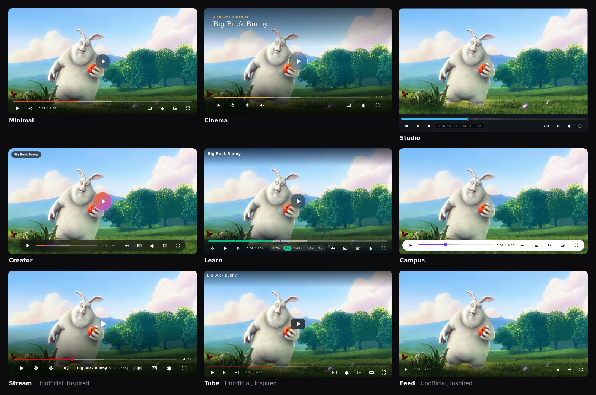

# Skins and theming



| Skin | Package | Character |
| --- | --- | --- |
| **Minimal** | `@tomato-player/skin-minimal` | Clean, light, the default. ~0.6 KB gz. |
| **Cinema** | `@tomato-player/skin-cinema` | Premium. Serif title, eyebrow, gold gradient, remaining time. |
| **Studio** | `@tomato-player/skin-studio` | Professional. Toolbar below the video, SMPTE timecode, frame step, A-B loop, 0.1×–4×. |
| **Creator** | `@tomato-player/skin-creator` | Floating glass pill, two-stop gradient, cast button. |
| **Learn** | `@tomato-player/skin-learn` | Education. Speed chips, ±10 s, chapter panel, large readable captions. |
| **Campus** | `@tomato-player/skin-campus` | Ported from the CampusLoop landing page. Paper sticker strip, "Play the video" pill, sticker captions, tap to unmute, muted autoplay in view, 9:16 on portrait phones. |
| Stream *(unofficial)* | `@tomato-player/skin-stream` | Streaming-service patterns: big icons, ±10, centered title, next episode. |
| Tube *(unofficial)* | `@tomato-player/skin-tube` | Video-platform patterns: thin expanding progress, theater toggle. |
| Feed *(unofficial)* | `@tomato-player/skin-feed` | Social-feed patterns: muted autoplay in view, tap to unmute, compact bar. |

> Stream, Tube and Feed are **unofficial, platform-inspired** designs. They contain no logos, fonts or assets of any company and imply no affiliation or endorsement.

## Options

Every skin is a factory, and every factory accepts `tokens`:

```ts
cinema({ eyebrow: 'Original', seekStep: 15, tokens: { accent: '#38bdf8' } });
studio({ fps: 24 });
learn({ rates: [1, 1.5, 2], chapterPanel: true });
stream({ subtitle: 'S1:E3', onNext: playNext, onBack: () => history.back() });
tube({ onNext, onTheater: (on) => layout.toggle(on) });
feed({ autoplayInView: true });
campus({ playLabel: 'Watch the launch', theme: 'auto', errorMessage: 'Back soon!' });
creator({ gradient: ['#f97316', '#a855f7'] });
```

## Design tokens

Tokens are CSS custom properties on the player root. Set them in CSS or through the `tokens` option:

| Token | Purpose |
| --- | --- |
| `--tp-accent` | Progress, focus ring, active states. |
| `--tp-fg` · `--tp-muted-fg` · `--tp-bg` · `--tp-surface` | Colors. |
| `--tp-track` · `--tp-buffer` · `--tp-thumb` | Slider colors. |
| `--tp-radius` · `--tp-font` | Shape and type. |
| `--tp-control-size` · `--tp-icon-size` · `--tp-gap` · `--tp-slider-height` | Density. |
| `--tp-duration` · `--tp-ease` | Motion. Zeroed automatically under `prefers-reduced-motion`. |

```css
.tp[data-skin='minimal'] { --tp-accent: hotpink; --tp-radius: 0; }
```

## State hooks for CSS

`data-paused`, `data-playing`, `data-started`, `data-ended`, `data-waiting`, `data-seeking`, `data-fullscreen`, `data-pip`, `data-idle`, `data-live`, `data-muted`, `data-captions`, `data-error`, `data-menu-open`, `data-muted-autoplay`, and `data-size="sm|md|lg"`. The root is also a size container (`container-type: inline-size`), so `@container` queries work inside skins.

## Strict CSP

```ts
import '@tomato-player/ui/base.css';
import '@tomato-player/skin-cinema/style.css';
createPlayer(el, { skin: cinema(), injectStyles: false });
```

## Switching at runtime

```ts
player.setSkin(tube());
player.setSkin(null); // headless: bring your own UI
```
